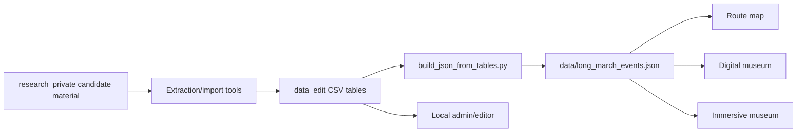
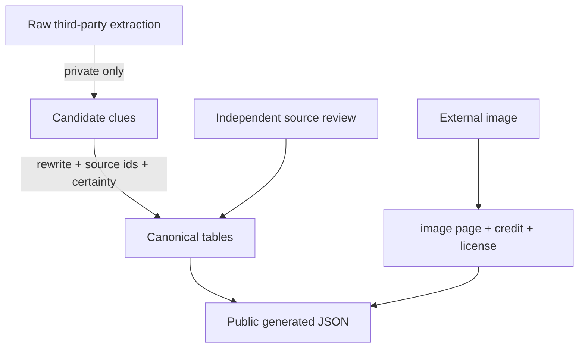

# Architecture

## Evidence boundary

The compiler guarantees reproducibility and reference integrity. It does not itself establish historical truth, copyright clearance, or exact geographic precision.
